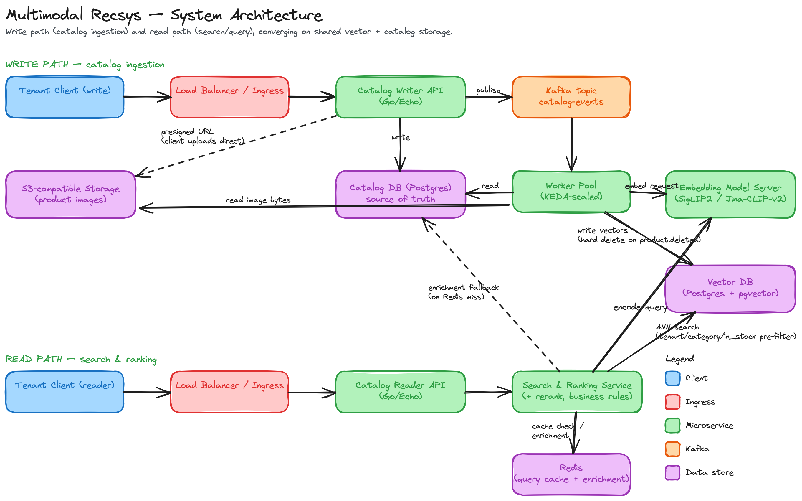

# Multimodal Recommendation System

A self-hosted, Kubernetes-native product search and recommendation system
supporting text and image (multimodal) queries, built on open-weight
embedding models (SigLIP2 / Jina-CLIP-v2).

> Repo: [github.com/newmizanur/multimodal-recommendation-system](https://github.com/newmizanur/multimodal-recommendation-system).
> Go module paths use the `multimodal-recsys` namespace (`github.com/multimodal-recsys/*`,
> per `go.work`) — that's the internal module/package naming, not the repo location.



*(Editable source: [`docs/architecture.excalidraw`](docs/architecture.excalidraw) — open in excalidraw.com.)*

See the accompanying article for the full write-up of design decisions.

## Layout

| Path | Language | Purpose |
|---|---|---|
| `catalog-writer-api/` | Go / Echo | Ingestion API — writes Postgres, publishes to Kafka, issues S3-compatible presigned URLs |
| `catalog-reader-api/` | Go / Echo | Public-facing read/search API, fronts the ranking service |
| `search-ranking-service/` | Go / Echo | Query embedding, ANN retrieval, rerank orchestration |
| `worker/` | Go | Kafka consumer — embeds products, writes vectors |
| `embedding-server/` | Python / FastAPI | GPU inference server (SigLIP2 / Jina-CLIP-v2) |
| `infra/helm/` | Helm | Per-service charts, incl. KEDA ScaledObject (Kafka trigger) and GPU tolerations |
| `infra/terraform/` | Terraform | Kubernetes-native Kafka (Strimzi), Postgres (CloudNativePG), Redis, plus an S3 bucket |
| `scripts/` | Python | Catalog seeding, ANN benchmarking |

## Go service architecture

Each Go service (`catalog-writer-api`, `catalog-reader-api`,
`search-ranking-service`, `worker`) follows the same clean-architecture
layering, minimal version — `cmd/` wires dependencies together and does
nothing else; every layer below it depends only on the interface of the
layer beneath it, never a concrete type two levels down:

```
cmd/server/main.go (or cmd/worker/main.go)   — wiring only, no logic
internal/
├── config/          — viper, DB/Kafka/S3 connections, Echo instance
├── apperror/         — one error type, HTTP status + stable code
├── auth/              — tenant API-key store (writer/reader only)
├── delivery/
│   ├── http/            — controllers, middleware, response envelope, routes
│   └── kafka/            — consumer loop (worker only, in place of delivery/http)
├── dto/               — request/response shapes + converter/ to persistence models
├── persistence/model/  — structs mapping 1:1 to DB rows
├── repository/         — the only layer allowed to hold SQL / ANN / cache queries
├── client/             — calls to *other services* (embedding server, ranking, rerank)
└── usecase/            — business logic; the only thing controllers call
```

A request flows `delivery → usecase → repository/client → back up`, and
nothing skips a layer — a controller never touches a repository
directly, a usecase never renders JSON. `search-ranking-service` and
`worker` split `repository` (their own stateful deps: ANN index, Redis,
vector DB) from `client` (calls to other services: embedding server,
cross-encoder) so it's obvious at a glance which dependencies are "our
data" vs "someone else's service".

Multi-tenancy: `catalog-writer-api` and `catalog-reader-api` require an
`X-API-Key` header scoped to the `:tenant_id` in the URL — see
`internal/auth/apikey.go` in each. The scaffold's example tenant is
`acme-marketplace` (fictional); the auth store is a static in-memory map
explicitly marked as scaffold-only, meant to be swapped for a real
tenant-key table before production use. `search-ranking-service` has no
tenant auth of its own — it's internal-only, reachable only from
`catalog-reader-api`, and should be restricted at the network layer
(NetworkPolicy / service mesh / private ClusterIP) rather than
re-implementing the same check a second time.

## Local dev quickstart

```bash
# 1. Bring up dependencies (Postgres, Redis, Redpanda for Kafka, MinIO for S3)
docker compose -f infra/docker-compose.dev.yml up -d

# 2. Run the embedding server
cd embedding-server && pip install -r requirements.txt && uvicorn app.main:app --reload

# 3. Run the Go services (separate shells), e.g.:
export KAFKA_BROKERS=localhost:9092
export KAFKA_TOPIC=catalog-events
export S3_ENDPOINT=http://localhost:9000   # MinIO — omit to use real AWS S3
export S3_BUCKET=product-images
export DEMO_TENANT_API_KEY=acme-marketplace-dev-key
cd catalog-writer-api && go run ./cmd/server
cd worker && KAFKA_CONSUMER_GROUP=worker go run ./cmd/worker
cd catalog-reader-api && go run ./cmd/server
cd search-ranking-service && go run ./cmd/server

# 4. Seed sample data for the example tenant
python scripts/seed-catalog.py --tenant acme-marketplace --api-key acme-marketplace-dev-key --count 500
```

Each service also ships a `config.json.example` — copy it to
`config.json` for local runs instead of exporting every env var by hand
(env vars still override it, which is what you want in containers).

Nothing above is tied to AWS except the S3-compatible object storage
call — Kafka, Postgres, and Redis all run as ordinary open-source
services, whether that's Redpanda/self-hosted Kafka, a managed Kafka
service, or containers on any cloud.

## Status

The repository layer is implemented and verified, not a scaffold anymore.
Every method behind `ProductRepository`, `CatalogRepository`,
`VectorRepository`, and `AnnRepository` is real `pgxpool`/`pgvector` SQL —
no `TODO`s left in any of them. `go build`/`go vet` are clean across all
four Go modules, and every query is tenant-scoped
(`grep -A3 "func (r \*pg" .../repository/*.go`). None of that is just
asserted — run `task dev:up && task migrate:up && task test:all` to see
it for yourself:

- [`catalog-writer-api/internal/repository/product_repository_test.go`](catalog-writer-api/internal/repository/product_repository_test.go) —
  tenant A creates a product; tenant B's `Get`/`Update`/`Delete` on it
  are all asserted to fail or no-op.
- [`worker/internal/repository/vector_repository_test.go`](worker/internal/repository/vector_repository_test.go) —
  `Upsert` called twice on the same `(product_id, embedding_type,
  source_ref)` asserted to leave exactly one row; `HardDeleteByProduct`
  under the wrong tenant asserted to be a no-op.
- [`search-ranking-service/internal/repository/ann_repository_test.go`](search-ranking-service/internal/repository/ann_repository_test.go) —
  tenant isolation and the `category_id`/`in_stock` pre-filters, asserted
  against seeded rows designed to leak if either were broken.
- Both [`worker/internal/repository/vector_repository_test.go`](worker/internal/repository/vector_repository_test.go)
  and [`search-ranking-service/internal/client/embed_client_test.go`](search-ranking-service/internal/client/embed_client_test.go)
  include a real `httptest.Server` matching the embedding server's
  `/embed` contract, called by the real `EmbedClient`, feeding the real
  repository — the "stand-in embedding server over HTTP" claim, made
  concrete and reproducible instead of asserted in prose.

Deliberately still stubbed: the cross-encoder rerank client (passthrough
on ANN score, pending a model decision), the Redis-miss enrichment
fallback in the search usecase, and a transactional outbox for the
Postgres-write + Kafka-publish gap in `catalog-writer-api` (a crash
between the two currently drops the event). The embedding server itself
(FastAPI + SigLIP2) is implemented but hasn't been run end-to-end against
the real model in this pass. See [article.md](article.md) for why, or read
the published write-up on LinkedIn: <https://lnkd.in/p/gQc9f8MZ>
